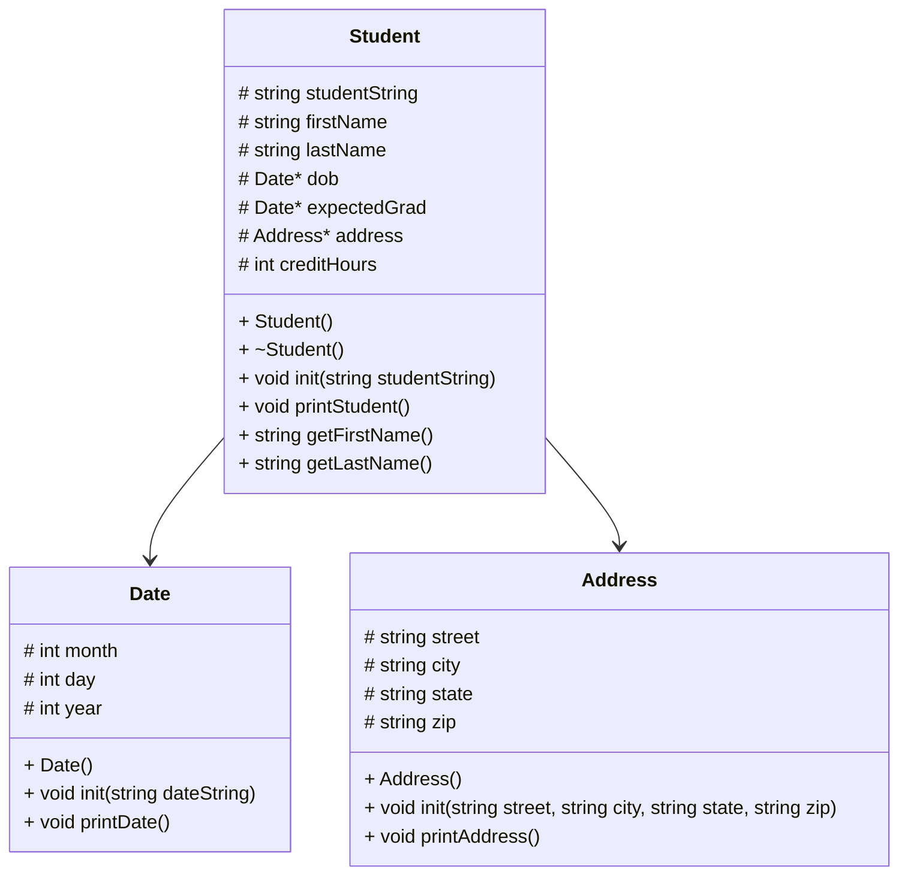

# Address Class
``` 
Address::init(street, city, state, zip):
  assign street to the street field
  assign city to the city field
  assign state to the state field
  assign zip to the zip field

printAddress():
  print street, city, state, and zip in the correct format

```
# Date Class
```
Date::init(dateString):
  create a stringstream using dateString
  define each piece of dateString as string:
  define month piece as monthString
  define day piece as dayString
  define year piece as yearString

 use getline + string stream + '/' delimiter to separate pieces
 read dateString up to first '/' to get month
 read dateString up to next '/' to get day
 read rest of dateString to get year

 convert monthString to integer
 convert dayString to integer
 convert yearString to integer


Date::printDate():
  create a string array of months[]:
  index 0 is blank
  index 1 is January
  index 2 is February
  ...
  index 12 is December

  print month[index] day, and year in correct format
  endl

```
# Student class
```
Student():
  initialize dob to nullptr
  initialize expectedGrad to nullptr
  initialize address to nullptr

Student::init(studentString):
  initialize a stringstream using studentString

  read line up to the first comma and assign chunk to variable firstName
  continue line up to the next comma and assign chunk to variable lastName

  initialize street variable as string
  initialize city variable as string
  initialize state variable as string
  initialize zip variable as string

  continue line up to the next comma and assign variable street
  continue line up to the next comma and assign variable city
  continue line up to the next comma and assign variable state
  continue line up to the next comma and assign variable zip

  allocate heap memory for Address and assign to address pointer
  initialize address pointer with street, city, state, and zip

  initialize dobString variable as string
  initialize gradString variable as string

  continue line up to the next comma and assign chunk to variable dobString
  continue line up to the next comma and assign chunk to variable gradString

  allocate heap memory for Date and assign to dob pointer
  initialize dob pointer with dobString

  allocate heap memory for Date and assign to expectedGrad pointer
  initialize expectedGrad pointer with gradString

  initialize creditString variable as string
  finish the end of line up and assign chunk to variable creditString

  convert creditString to an integer
  store resulting integer in creditHours

~Student():
  free the Date object pointed to by dob
  free the Date object pointed to by expectedGrad
  free the Address object pointed to by address

printStudent():
  print student first name + space + last name

  print student address

  print "DOB:" and the date of birth using dob
  print "Grad:" and the expected graduation date using expectedGrad

  print student total credits with "Credits:" label

getFirstName():
  return firstName

getLastName():
  return lastName

```
# main Function
```
main():
  create an empty vector of Student pointers
  load students.csv into the vector

  initialize choice as an empty string

  while choice is not "0":
    display the menu and read the user's choice

    if choice is "1":
      print all student names

    else if choice is "2":
      print all student data

    else if choice is "3":
      search for a student by last name

    else if choice is not "0":
      print an invalid-choice message

  delete all Student objects and clear the vector
  return 0

```
# loadStudents Function
```
loadStudents(students):
  open students.csv

  if file can't be opened:
    print error message
    return

  while there are still lines in the file:
    create Student object
    initialize Student using the line
    add Student pointer to vector

  close file

```
# showStudentNames Function
```
showStudentNames(students):
  for each Student pointer in vector:
    print student last name
    print comma + space
    print student first name
    continue to next line

```
# printStudents Function
```
printStudents(students):
  for each Student pointer in vector:
    print student data
    print line

```
# findStudent Function
```
findStudent(students):
  prompt user for last name
  read prompt
  found = false

  for each Student pointer in vector
    check whether the student's last name contains the search text

    if there is a match:
      found = true
      print student data
      print blank line

    if found == false
      print no students matching message

```
# menu Function
```
menu():
  print the menu option
  prompt user to choose from options 0-3
  read user's input
  return choice

```
# delStudents Function
```
delStudents(students):
  for each Student pointer in vector:
    delete Student object

  clear vector

```
