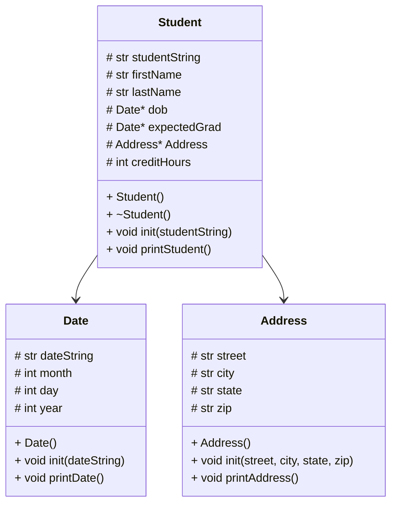

# Address Class
``` 
include header

Address::init(street, city, state, and zip as strings):
  assign str 'street' to 'street' in Address class
  assign str 'city' to 'city' in Address class
  assign str 'state' to 'state' in Address class
  assign str 'zip' to 'zip' in Address class

printAddress():
  print full address (street, city, state, zip) in correct format
  endl

```
# Date Class
```
Date::init(dateString):
  create string stream for dateString
  define each piece of dateString as string:
  define month piece as monthString
  define day piece as dayString
  define year piece as yearString

 use getline + string steam + '/' delimiter to separate pieces
 read dateString up to first '/' to get month
 read dateString up to next '/' to get day
 read rest of dateString to get year

 convert monthString to integer
 convert dayString to integer
 convert yearString to integer


Date::printDate():
  create a string array of months[]:
  index 0 is blank
  index 1 is January
  index 2 is February
  ...
  index 12 is December

  print month[index] day, and year in correct format
  endl

```
# main Function
```
main():
  create empty vector of student pointers
  load students.csv into vector

  create variable 'choice' as an empty string

  while choice is not 0:
    print menu + receive user choice input

    if choice is 1:
      print all students names

    else if choice is 2:
      print all student data

    else if choice is 3:
      search for student by last name

    else if choice is not 0:
      output invalid message

  free all student objects + clear vector
  return 0

```
# loadStudents Function
```
loadStudents(students):
  open students.csv

  if file can't be opened:
    print error message
    return

  while there are still lines in the file:
    create Student object
    initialize Student using the line
    add Student pointer to vector

  close file

```
# showStudentNames Function
```
showStudentNames(students):
  for each Student pointer in vector:
    print student last name
    print comma + space
    print student first name
    continue to next line

```
# printStudents Function
```
printStudents(students):
  for each Student pointer in vector:
    print student data
    print line

```
# findStudent Function
```
findStudents(students):
  prompt user for last name
  read prompt
  found == false

  for each Student pointer in vector
    check if any student's last name contains anything from the user input

    if there is a match:
      found == ture
      print student data
      print blank line

    if found == false
      print no students matching message

```
# menu Function
```
menu():
  print the menu option
  prompt user to choose from options 0-3
  read user's input
  return choice

```
# delStudents Function
```
delStudents(students):
  for each Student pointer in vector:
    delete Student object

  clear vector

```
